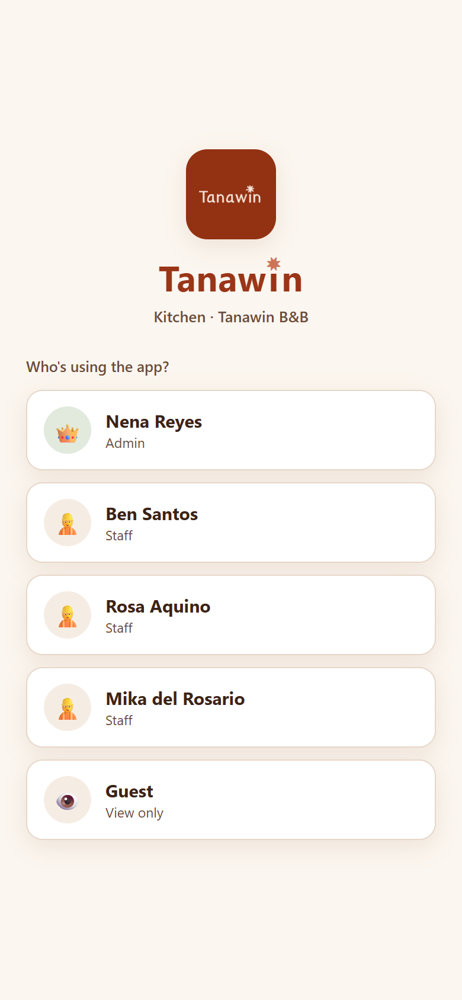
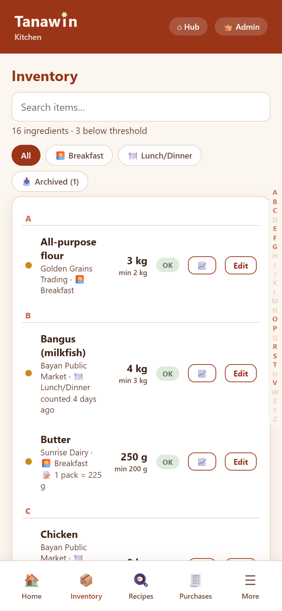
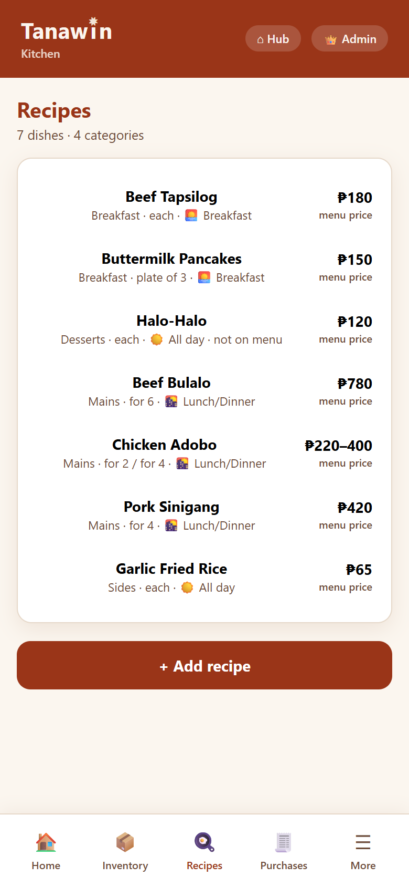
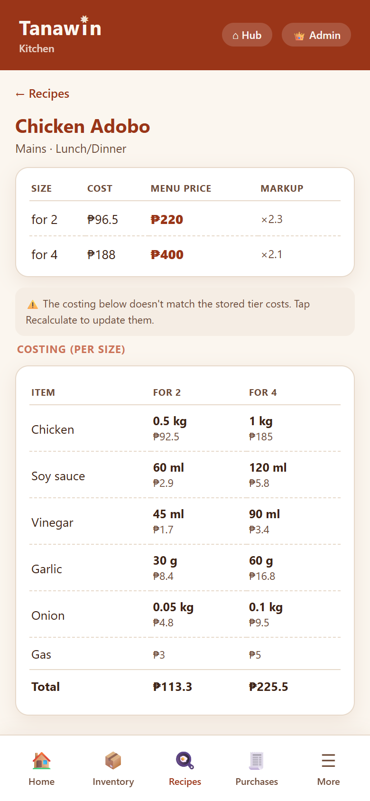
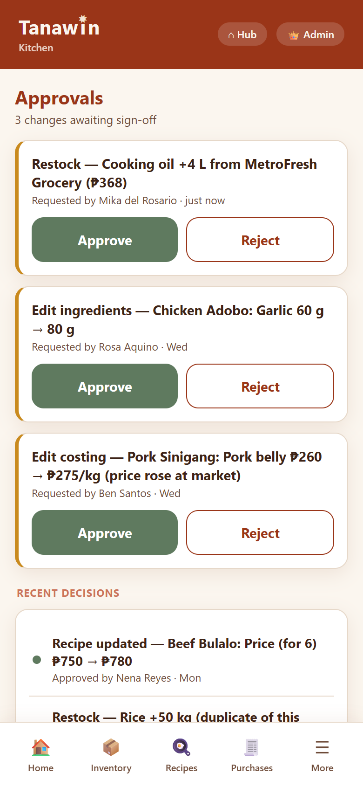
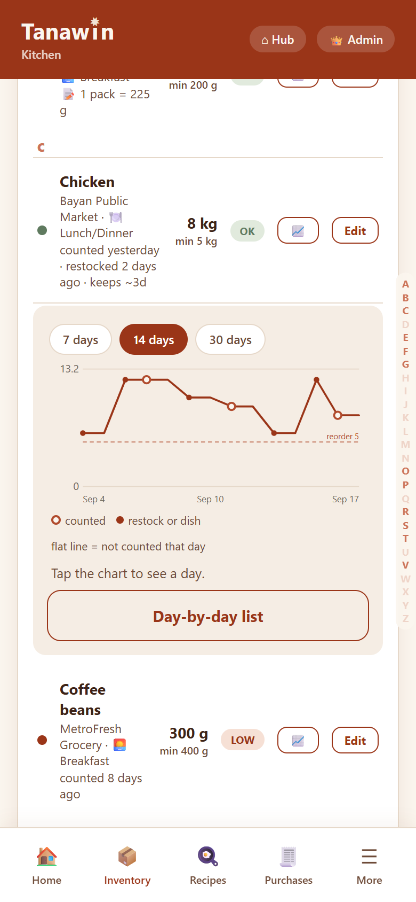
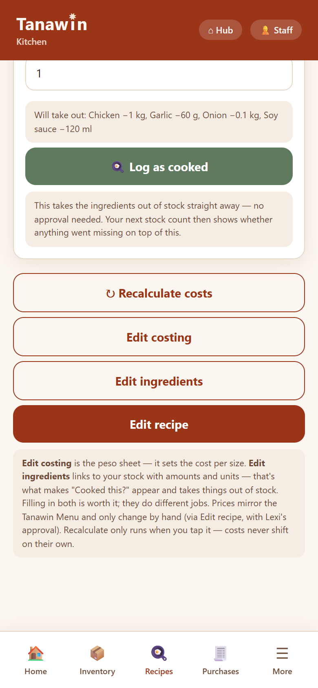

# Tanawin Kitchen

Mobile-first kitchen management app for Tanawin Bed & Breakfast (Bataan, PH).
Inventory, recipe costing, waste logging, and purchases with an owner-approval
queue — used by the owner remotely and kitchen staff on-site.

## Stack

- React + Vite (plain JS)
- Supabase (Postgres, shared project with Tanawin Finance — Kitchen reads
  Finance's `entries` table read-only, never writes to Finance tables)
- PIN-based login (no Supabase Auth), mirroring the Finance app
- Hosted on Cloudflare Workers (static assets)

## Key product rules

- Staff structural/financial changes (recipe edits, ingredient-line edits,
  purchases) queue in `approvals` for the admin; admin changes apply directly.
- Cost-per-serving recalculation is **manual only** (a button — never automatic),
  and it writes cost, never price.
- **Prices are hand-set per size** and mirror the Tanawin Menu app (the authority
  on final prices). Each recipe carries per-size tiers (`{label, price, cost}`),
  e.g. "for 2 / for 4"; costing shows the markup against the hand-set price.
- Recipe line units can differ from how an item is stocked (a recipe in grams,
  an item bought by the kilo); the app converts where it safely can and refuses
  to guess where it can't (e.g. packs → grams).
- Waste logging is a record only; stock truth comes from Count Stock.
- Finance import is read-only reconciliation: match a Finance purchase to an
  ingredient, confirm it physically arrived, sync. Item matches are remembered.

## Development

```
npm install
npm run dev
```

Create `.env.local` (not committed):

```
VITE_SUPABASE_URL=<project url>
VITE_SUPABASE_ANON_KEY=<publishable key>
```

Database migrations live in `supabase/` (numbered .sql files, run in the
Supabase SQL editor).

## Deploy

Cloudflare git-connected build: `npm run build`, output `dist/`, config in
`wrangler.jsonc` (SPA fallback enabled). Set the two `VITE_*` env vars in the
Cloudflare build settings.

## Screenshots

Everything shown below is **made-up demo data** — fictional staff, suppliers,
recipes and prices. The app shares a live production database, so these were
captured against an in-memory demo build (`VITE_DEMO=1`), never the real data.

<table>
  <tr>
    <td align="center" width="25%"><br>Staff picks their name, PIN login</td>
    <td align="center" width="25%"><br>Inventory: search, A–Z jump, low-stock, ages</td>
    <td align="center" width="25%"><br>Recipes by category with price ranges</td>
    <td align="center" width="25%"><br>Per-size costing grid &amp; markup</td>
  </tr>
  <tr>
    <td align="center" width="25%"><br>Owner approval queue</td>
    <td align="center" width="25%"><br>Per-item stock history chart</td>
    <td align="center" width="25%"><br>Staff view: log a cooked dish, edits need approval</td>
    <td align="center" width="25%"></td>
  </tr>
</table>
